# qrbin

**A minimal, offline-first QR generator.**

`qrbin` reads a payload and writes one QR image to stdout. The running program has no telemetry, analytics, update check, account system, or outbound network connection. The first build on a machine may download crates. After that, `make` compiles offline.

```text
Read payload → choose a renderer → write PNG or SVG to stdout → exit
```

The package version is 0.1.9. Omit `--theme` and the classic renderer runs. Set a theme and the flags below style the mark. See [CHANGELOG.md](CHANGELOG.md). GitHub release builds are described in [docs/RELEASING.md](docs/RELEASING.md).

## Limits

`qrbin` does not log the payload, and error text does not include it. It writes the image to stdout. `--output` does not exist. A redirect such as `> qr.png` is the shell.

It cannot protect a payload from the operating system, shell history, a compromised host, swap, or a core dump. Command-line arguments can appear in process listings. Prefer stdin for anything sensitive.

A themed payload must be valid UTF-8. The classic renderer accepts any bytes.

## Install and build

Run these from the repository root. [`Makefile`](Makefile) starts the Mac build. [`Cargo.toml`](Cargo.toml) is the only package. There is no `qrbin-cli` crate. The license is [MIT](LICENSE).

The program does not update itself. `make` writes `target/release/qrbin` and does not copy it onto `PATH`.

### Which Macs can run it

* An Intel Mac from 2014 or newer, running macOS 10.12 Sierra or newer. The binary is marked compatible with that floor. `make` refuses the result if the stamp is newer than 10.12.
* An Apple silicon Mac running macOS 11 Big Sur or newer. `make build-silicon` checks that stamp.
* The 2008 17-inch MacBook Pro stops at OS X 10.11. Current Rust does not build a binary that system can load.

2014 through the last Intel Mac are one compile: `x86_64-apple-darwin`. Every Apple silicon chip is the other compile: `aarch64-apple-darwin`.

### See the compilers before you build

* `make doctor` prints the rustup `cargo` and `rustc` that `make` calls, the Homebrew cargo it ignores, the 10.12 deployment target, the Windows linker, and the Linux glibc floor.
* `cargo --version` is Homebrew Rust when `/usr/local/bin` comes first. Its standard library is stamped macOS 13.0, and it has no Apple silicon standard library. A 2014 Mac cannot load that Intel binary. Do not call it for this build. `make` pins `RUSTC` to rustup's compiler so the Homebrew one cannot be selected by accident.

[`rust-toolchain.toml`](rust-toolchain.toml) tells rustup which extra targets to install. It does not change the default build target. Homebrew's cargo ignores that file.

### Build the Intel binary

`make` and `make build` are the same command. Both compile `target/release/qrbin` and leave it there. Neither copies a binary onto `PATH`.

* `make`
* `vtool -show-build target/release/qrbin` shows the stamp. Look for `minos 10.12` or `version 10.12`. [`packaging/check-macos-minos.sh`](packaging/check-macos-minos.sh) fails the build when the minimum is newer than 10.12.
* `./target/release/qrbin --version` runs that fresh build.

Do not copy this file to `/usr/local/bin` or `~/.local/bin`. The published Mac install is Homebrew, below.

### Build the Apple silicon binary

This Intel Mac can cross-compile it. The file is not installed here, because this machine cannot run it.

* `make build-silicon`
* The binary is `target/aarch64-apple-darwin/release/qrbin`.
* `vtool -show-build target/aarch64-apple-darwin/release/qrbin` should show macOS 11.0.

### Build the Windows exe

This builds `qrbin.exe` for 64-bit Windows 10 and Windows 11. It does not install that file on the Mac. The Rust target is `x86_64-pc-windows-gnu`. The linker is MinGW, installed once with Homebrew.

* `brew install mingw-w64`
* `~/.cargo/bin/rustup target add x86_64-pc-windows-gnu`
* `make build-windows`
* The exe is `target/x86_64-pc-windows-gnu/release/qrbin.exe`.
* `file target/x86_64-pc-windows-gnu/release/qrbin.exe` should say `PE32+ executable`.

The GitHub Release zip is a separate unsigned build. Windows SmartScreen warns the first time somebody runs that `qrbin.exe`. The warning is the missing signature.

`make doctor` also prints whether the MinGW linker is installed. `make` and `make build` stay the Intel Mac build.

### Homebrew

The formula is [`packaging/homebrew/qrbin.rb`](packaging/homebrew/qrbin.rb). It builds with `cargo install --locked` into Homebrew's prefix. `make` does not install.

Public names, already written into [`Cargo.toml`](Cargo.toml) and the formula:

* GitHub account `pesty-sh`, source repo `https://github.com/pesty-sh/qrbin`
* Tap repo `https://github.com/pesty-sh/homebrew-tap`
* Homepage `https://pesty.sh`
* Contact `pesty@pesty.sh`

The GitHub account `pesty-sh` exists, and both repositories are public. There is a separate Homebrew cask named `pesty` (a clipboard app). This formula is named `qrbin`.

`brew install` compiles with Homebrew's Rust. That compiler stamps macOS 13.0. People who install from Homebrew are on a current Mac. The 2014 build is `make`, and that file stays in `target/release/qrbin`.

On this Intel Mac, Homebrew's prefix is `/usr/local`, so a tap install puts `qrbin` on `PATH` at `/usr/local/bin/qrbin`. On Apple silicon the prefix is `/opt/homebrew`. `make` does not write either of those paths.

* `brew --prefix` prints `/usr/local` on this Mac, and `/opt/homebrew` on Apple silicon.

### Install with Homebrew

Trust is stored on your Mac. Run it once for this tap. It covers `qrbin` and any later formula in the tap.

* `brew tap pesty-sh/tap`
* `brew trust --tap pesty-sh/tap`
* `HOMEBREW_NO_AUTO_UPDATE=1 brew install --HEAD pesty-sh/tap/qrbin`
* `qrbin --version`

`--HEAD` installs the latest commit on `master`. The first install compiles with Homebrew's Rust and needs a network connection. After that, `qrbin` with no path is the Homebrew build. A fresh build from this repository stays at `./target/release/qrbin` and is not copied onto `PATH`.

When you want a numbered release, follow [docs/RELEASING.md](docs/RELEASING.md). The short version, after the pull request is green:

* `git tag -a v0.1.9 -m "qrbin 0.1.9"`
* `git push origin v0.1.9`

That tag builds the GitHub Release. Homebrew still compiles from the source tarball. There is no bottle.

* `brew install pesty-sh/tap/qrbin`

The formula downloads `https://github.com/pesty-sh/qrbin/archive/refs/tags/v0.1.9.tar.gz`. Its `sha256`, checked twice from that download, is `afc109f18bc91139a26d1f881b1e590112ad53ad38e17b9d4dd2ab78c1a0e81e`. A later tag needs the same two downloads before the hash in the tap is changed.

The formula test runs `qrbin --version` and checks that one small PNG starts with the PNG signature. It does not run `cargo test`.

### Linux package

`make linux` builds two binaries on this Mac. It does not use Docker, and it does not replace `/usr/local/bin/qrbin`.

The Makefile sets `LINUX_GLIBC` to `2.27`. That is the glibc Ubuntu 18.04 ships. A program linked to 2.27 also runs on a newer glibc, so this one floor covers the later releases:

| System | glibc it ships |
|---|---|
| Ubuntu 18.04 | 2.27 |
| Ubuntu 20.04 | 2.31 |
| Ubuntu 22.04 | 2.35 |
| Ubuntu 24.04 | 2.39 |
| Debian 10 | 2.28 |
| Debian 11 | 2.31 |
| Debian 12 | 2.36 |
| Debian 13 | 2.41 |
| Arch Linux | newer than 2.27 |

Intel and AMD are the same 64-bit PC build. 64-bit ARM is a second build.

* `make linux`
* `file dist/qrbin-linux-amd64` should say `ELF 64-bit` and `x86-64`
* `file dist/qrbin-linux-arm64` should say `ELF 64-bit` and `aarch64`

`make deb` is the same command. The files are:

* `dist/qrbin-linux-amd64` and `dist/qrbin_0.1.9-1_amd64.deb` for Intel and AMD
* `dist/qrbin-linux-arm64` and `dist/qrbin_0.1.9-1_arm64.deb` for 64-bit ARM

These `.deb` files depend on glibc 2.27. The GitHub Release ships a different static musl `.deb` with the same filename. Apt publishes this glibc build, not the musl one.

The signed repository is [pesty-sh/apt](https://github.com/pesty-sh/apt), served at `https://pesty-sh.github.io/apt`. On the Mac that holds the signing key, `python3 publish.py` takes these two files. It refuses a package whose `Depends` line is empty, which is how the musl GitHub package is marked.

The first run downloads Zig 0.16.0 from ziglang.org into `~/.cache/qrbin` and installs `cargo-zigbuild` with rustup. Do not install Zig from Homebrew on this Mac. Homebrew would compile Zig from source, and that build needs a newer Clang than macOS 13 has.

## Two renderers, one binary

Omit `--theme` and `--theme-file` and qrbin uses the `qrcode` 0.14 renderer. That path is the classic mark: black modules, white ground, PNG as 8-bit grayscale. `--size` is a minimum. The library rounds up to the module grid, so `--size 256` can come out 264×264 and `--size 64` can come out 66×66. SVG uses the same grid, drawn with black `#000000` and white `#ffffff`.

Set `--theme`, or pass a `--theme-file` that names one, and qrbin uses `qr-code-styling` 0.2.4 with its `png` feature only. SVG rendering comes with that crate. PNG is rasterized from the SVG after any frame is applied, so a frame appears in both formats. Themed PNG is 8-bit RGBA at the exact `--size` in both dimensions.

Both paths are linked into the one executable. A classic run still uses the `qrcode` writer. The file is about 3.5 MB because the themed path includes `resvg`. JPEG, WebP, PDF, and CMYK stay disabled in 0.1.9. There is no `--type` flag.

The styling crate's own error-correction default is quartile. qrbin always passes `--ecc` through. Its margin is in pixels, so qrbin does not forward the classic module count. See [Quiet zone](#quiet-zone).

Style flags (`--fg`, `--bg`, `--gradient`, `--from`, `--to`, `--shape`, `--logo`, `--frame`, `--frame-color`, `--label`) require `--theme` or a theme inside `--theme-file`. A theme file with no `theme` key, and no `--theme` on the command, is an error.

## Reference

```text
qrbin [OPTIONS] [PAYLOAD]
```

The examples below use `./target/release/qrbin`, the binary `make` just wrote. A Homebrew install is `qrbin` on `PATH`.

| Option | Meaning | Default |
|---|---|---|
| `[PAYLOAD]` | Text or bytes to encode. If omitted, qrbin reads stdin until EOF | stdin |
| `-f`, `--format` | `png` or `svg` | `png` |
| `-s`, `--size` | Classic: minimum width and height in pixels. Themed: exact width and height | `512` |
| `-m`, `--margin` | Quiet zone. `0` omits it. See below | `4` |
| `-e`, `--ecc` | `low`, `medium`, `quartile`, or `high` | `medium` |
| `--theme` | `plain`, `rounded`, `dots`, or `classy` | classic renderer |
| `--fg` | Module and finder color, hex | `#000000` |
| `--bg` | Background color, hex. Stays flat when the dots use a gradient | `#ffffff` |
| `--gradient` | `linear` or `radial`, painted on the dots | none |
| `--from`, `--to` | Gradient stops, hex. Both are required when `--gradient` is set | none |
| `--shape` | `square` or `circle` | `square` |
| `--logo` | Local image file, inlined into the mark | none |
| `--frame`, `--border-width` | Border width in pixels | none |
| `--frame-color`, `--border-color` | Border color, hex. Requires a border width | `#000000` |
| `--label`, `--text` | Text on the border. Requires a border width | none |
| `--theme-file` | Local TOML file. A flag overrides the same key in the file | none |

Hex values may include a leading `#`. Three, six, and eight digits are accepted. An invalid color names the color value and does not name the payload.

| ECC | Capacity | Use |
|---|---|---|
| `low` | Highest | Clean, high-contrast marks |
| `medium` | Default | Ordinary links and text |
| `quartile` | Higher | Damaged print, modest decoration |
| `high` | Highest | `--shape circle`, `--logo`, or heavy styling |

### Quiet zone

Classic `--margin` is a switch. Any value other than `0` asks `qrcode` for its fixed 4-module quiet zone. `0` turns that zone off. The number `4` is only the default "on".

Themed `--margin` is also a switch, then a pixel size. `0` omits padding. Any other value uses a quiet zone of `size / 16` pixels, and at least 1. `--size 256` with the default margin is a 16-pixel pad. `--size 512` is a 32-pixel pad.

### Themes

A theme picks the module shape and the two finder shapes. Color, gradient, circle, logo, and frame are overrides on top of that choice.

| Theme | Modules | Finder squares | Finder centers |
|---|---|---|---|
| `plain` | Square | Square | Square |
| `rounded` | Rounded | Extra rounded | Dot |
| `dots` | Circular dots | Dot | Dot |
| `classy` | Classy rounded | Extra rounded | Dot |

Finders inherit the foreground color. A gradient is applied to the data dots. The background stays one flat color. `--from` is the linear start and the radial center. `--to` is the linear end and the radial edge. All three of `--gradient`, `--from`, and `--to` are required together.

### Circle

`--shape circle` pulls the mark into a disc and adds modules around the rim so the edge reads as round. Those extra modules are not payload. They reduce the quiet area a scanner expects. Pass `--ecc high`.

### Logo

`--logo` reads a local file and embeds those bytes. The path is rejected when it contains `://`, so a URL is not fetched and is not written into the SVG. The image is about a quarter of the code width, and the modules behind it are hidden. That covering needs `--ecc high`.

The title mark is `assets/logo.png`. `assets/logo.svg` is the downloaded wordmark, drawn in white. The PNG is that drawing filled `#1a1a1a`, with a little padding, so it reads on a light ground.

The same rule applies to a `logo` path inside a theme file.

### Frame

`--frame` sets the border width in pixels. `--border-width` is the same flag. `--frame-color` (or `--border-color`) sets its color, default black. `--label` (or `--text`) sets the border text. On a square mark the text sits on the bottom edge. On a circle the border is a ring, the mark is inset by that width, and the text follows the lower arc in the background color, sized from the width. Color and text without a width are errors.

The frame is applied to the SVG, then a PNG is rasterized from that SVG. A label can cause a font lookup on local disk. qrbin does not offer a border image. That styling API would copy a path or URL string into an SVG link, and a viewer could then fetch it.

### Theme file

`--theme-file` reads a local TOML file. Unknown keys are rejected. There is no remote config.

```toml
theme = "classy"
fg = "1a1a1a"
bg = "f7f3ea"
gradient = "linear"
from = "5b21b6"
to = "2563eb"
shape = "circle"
logo = "./mark.png"
frame = 12
frame_color = "111111"
label = "qrbin"
```

Every key is optional except that some theme must be chosen: `theme` in the file, or `--theme` on the command. When both set a value, the command wins. `format`, `size`, `margin`, and `ecc` stay on the command line.

A gradient in the file still needs `gradient`, `from`, and `to` together. A border color or text in the file still needs `frame`.

### Errors

Failures go to stderr as `qrbin error: …` and the process exits 1. The payload is not copied into that line.

| Condition | Result |
|---|---|
| Empty argument or empty stdin | `payload is empty` |
| Themed payload is not UTF-8 | `payload is not valid text` |
| Style flag with no theme | `pass --theme, or set theme in --theme-file` |
| `--gradient` without both stops, or a stop without `--gradient` | `gradient needs --gradient, --from, and --to` |
| `--frame-color` or `--label` without a border width | `border color and text need --frame or --border-width` |
| Bad hex | `invalid color: …` |
| Logo path containing `://` | `logo must be a local file` |
| Unknown key in the theme file | `invalid theme file: …` |

## Examples

Classic PNG. Grayscale, size is a minimum:

```bash
./target/release/qrbin \
  "https://example.com" \
  --format png \
  --size 256 \
  > qr.png
```

Classic SVG:

```bash
./target/release/qrbin \
  "https://example.com" \
  --format svg \
  > qr.svg
```

Stdin:

```bash
echo "https://example.com" | \
  ./target/release/qrbin \
  --format png \
  > qr.png
```

High error correction and no quiet zone:

```bash
./target/release/qrbin \
  "https://example.com" \
  --ecc high \
  --margin 0 \
  --format png \
  --size 512 \
  > qr.png
```

Rounded modules, exact 256×256 RGBA PNG:

```bash
./target/release/qrbin \
  "https://example.com" \
  --theme rounded \
  --format png \
  --size 256 \
  > qr-rounded.png
```

Dots as SVG:

```bash
./target/release/qrbin \
  "https://example.com" \
  --theme dots \
  --format svg \
  > qr-dots.svg
```

Classy from stdin:

```bash
echo "https://example.com" | \
  ./target/release/qrbin \
  --theme classy \
  --format png \
  > qr-classy.png
```

Plain theme, high correction, padding omitted:

```bash
./target/release/qrbin \
  "https://example.com" \
  --theme plain \
  --ecc high \
  --margin 0 \
  --format png \
  --size 512 \
  > qr-plain.png
```

Flat colors:

```bash
./target/release/qrbin \
  "https://example.com" \
  --theme classy \
  --fg 1a1a1a \
  --bg f7f3ea \
  --format png \
  --size 512 \
  > qr-classy.png
```

Two-stop linear gradient on the dots. The background stays `--bg`:

```bash
./target/release/qrbin \
  "https://example.com" \
  --theme dots \
  --gradient linear \
  --from 5b21b6 \
  --to 2563eb \
  --ecc high \
  --format png \
  --size 512 \
  > qr-dots.png
```

Circle. High correction compensates for the rim modules:

```bash
./target/release/qrbin \
  "https://example.com" \
  --theme rounded \
  --shape circle \
  --ecc high \
  --format png \
  > qr-circle.png
```

Local logo:

```bash
./target/release/qrbin \
  "https://example.com" \
  --theme classy \
  --fg 1a1a1a \
  --bg f7f3ea \
  --logo assets/logo.png \
  --ecc high \
  --format png \
  --size 1024 \
  > library/logo-title.png
```

Frame and bottom label:

```bash
./target/release/qrbin \
  "https://example.com" \
  --theme plain \
  --frame 12 \
  --frame-color 111111 \
  --label qrbin \
  --format png \
  > qr-frame.png
```

Theme file. Flags on this command override keys in `./theme.toml`:

```bash
./target/release/qrbin \
  "https://example.com" \
  --theme-file ./theme.toml \
  --format png \
  > qr-brand.png
```

## Development

Requirements: Rust stable, Cargo, and Git. `make linux` downloads Zig 0.16.0 on the first run. It does not need Docker.

```bash
cargo test
cargo clippy --all-targets -- -D warnings
cargo fmt --all -- --check
```

`cargo test` checks the classic grayscale PNG, a themed RGBA PNG at the requested size, SVG from a theme file, a gradient, a frame, a circle, a local logo, and the rejections for a remote logo, a bad color, a partial gradient, and a style flag with no theme.

`cargo test --test cli_test library_examples` writes the appendix images into `library/`.

## Gallery

<table>
  <tr>
    <td align="center"><br><strong>classic</strong></td>
    <td align="center"><br><strong>plain</strong></td>
    <td align="center">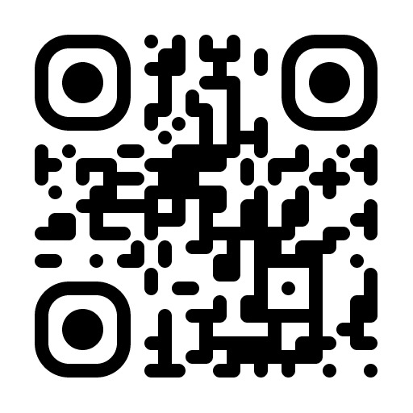<br><strong>rounded</strong></td>
  </tr>
  <tr>
    <td align="center">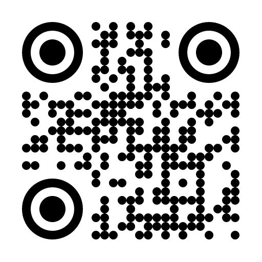<br><strong>dots</strong></td>
    <td align="center">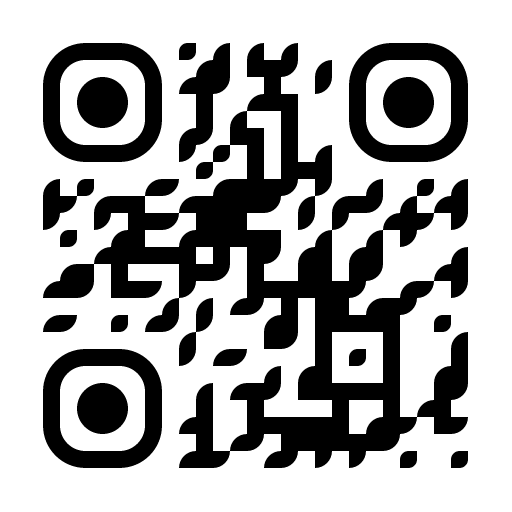<br><strong>classy</strong></td>
    <td align="center">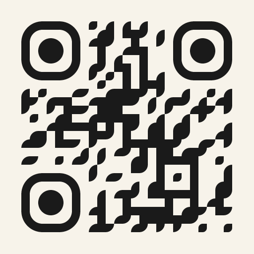<br><strong>classy-colors</strong></td>
  </tr>
  <tr>
    <td align="center">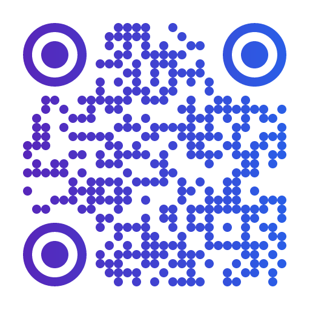<br><strong>dots-gradient-linear</strong></td>
    <td align="center">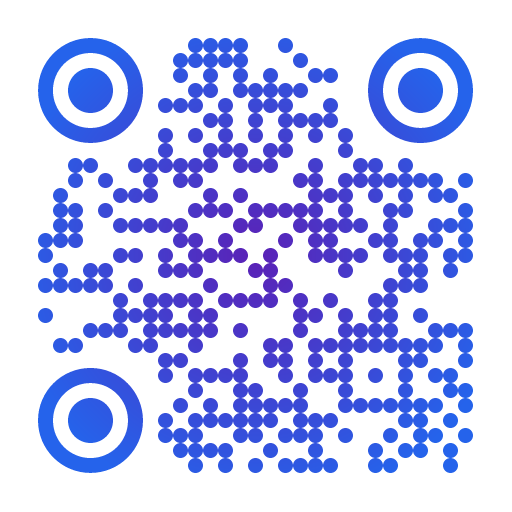<br><strong>dots-gradient-radial</strong></td>
    <td align="center"><br><strong>rounded-circle</strong></td>
  </tr>
  <tr>
    <td align="center">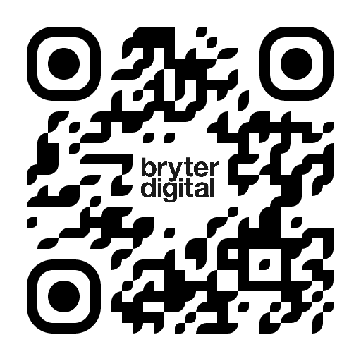<br><strong>classy-logo</strong></td>
    <td align="center">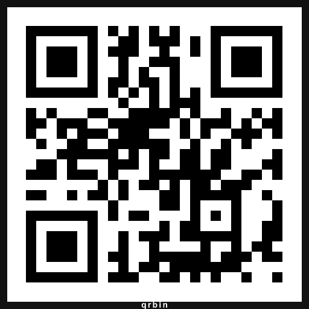<br><strong>plain-frame</strong></td>
    <td align="center">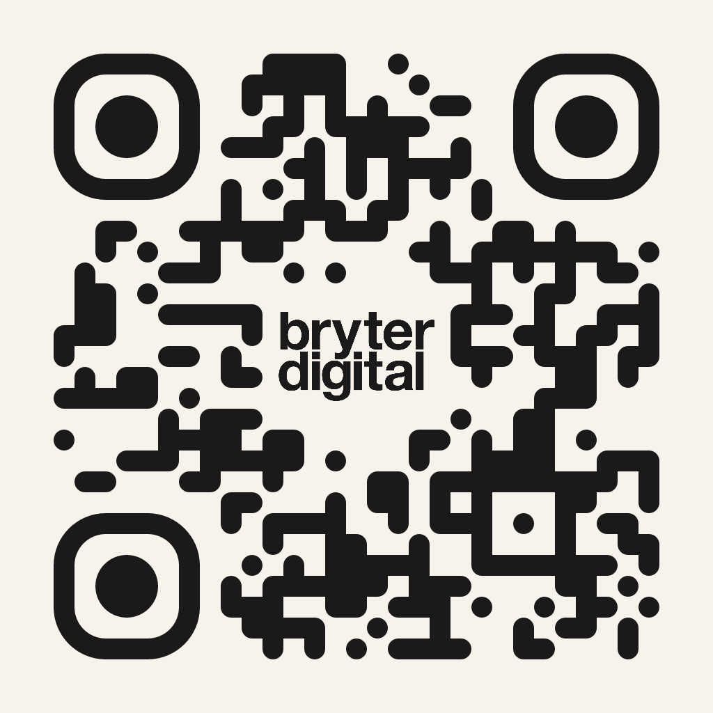<br><strong>logo-rounded</strong></td>
  </tr>
  <tr>
    <td align="center"><br><strong>logo-title</strong></td>
    <td align="center">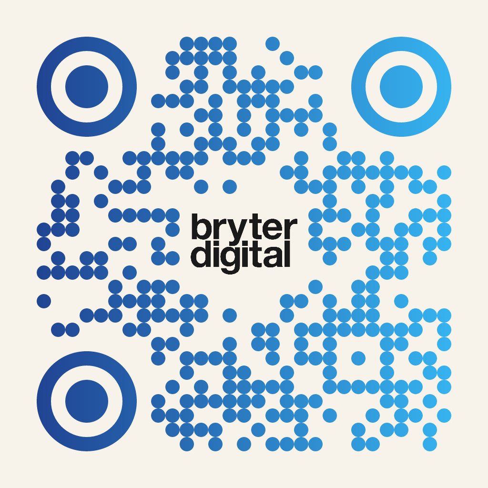<br><strong>logo-linear-blue</strong></td>
    <td align="center">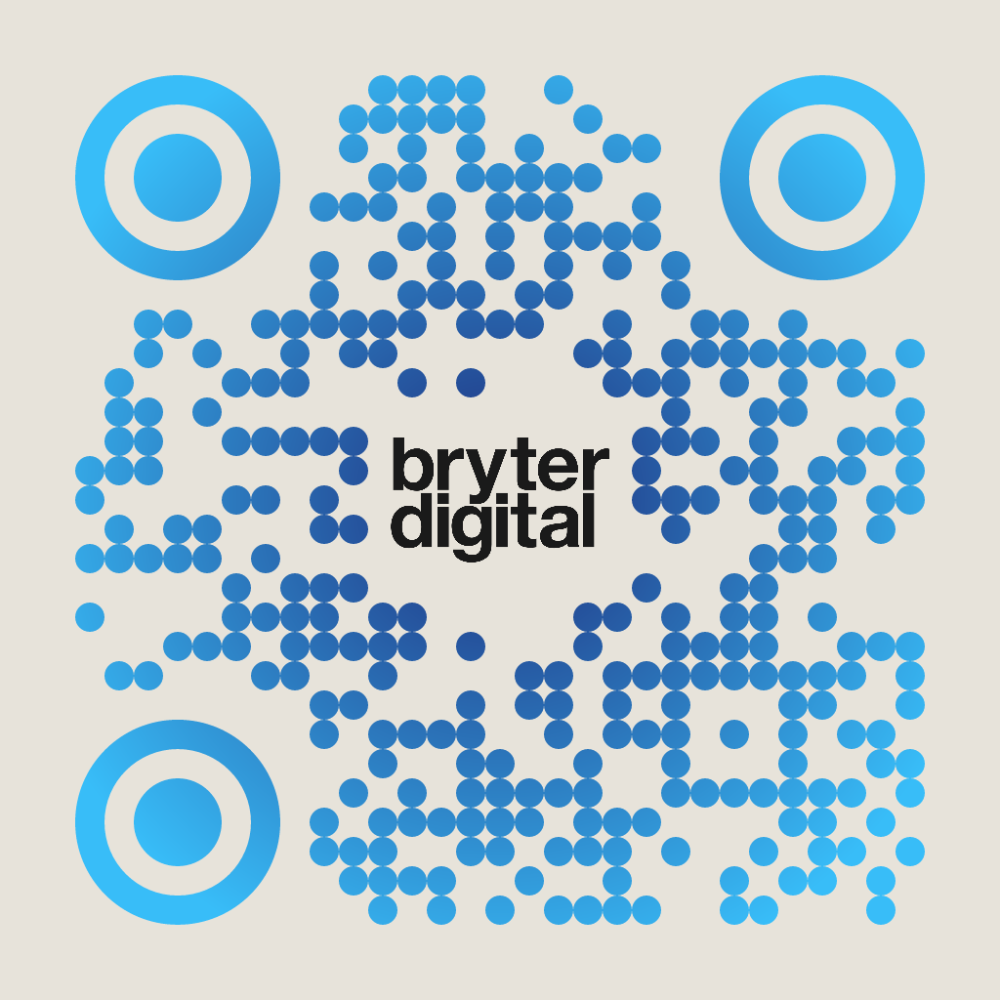<br><strong>logo-radial-blue</strong></td>
  </tr>
  <tr>
    <td align="center">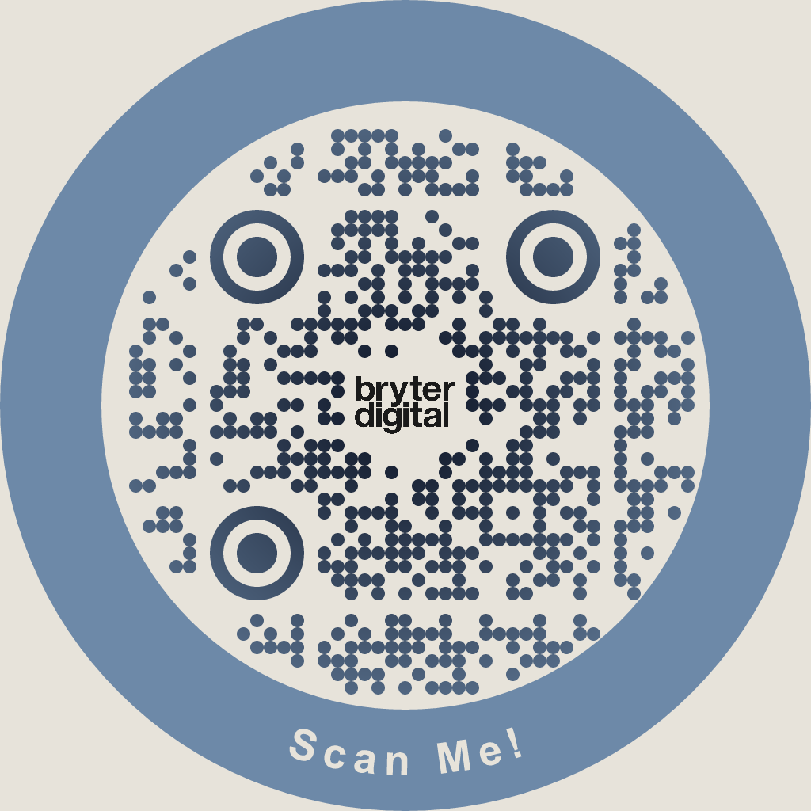<br><strong>logo-radial-ring</strong></td>
    <td align="center">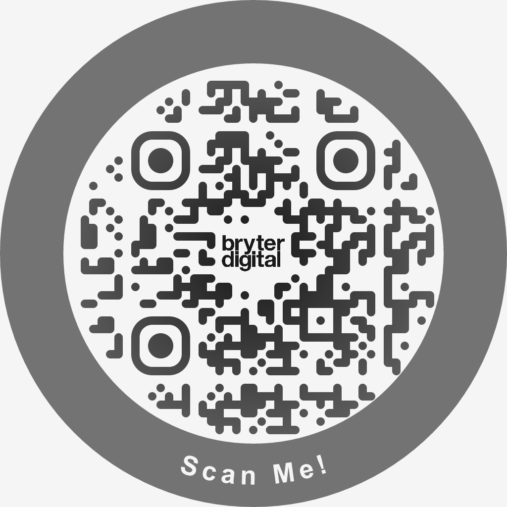<br><strong>logo-rounded-circle</strong></td>
    <td></td>
  </tr>
</table>

## Appendix: library examples

These are the commands that produced a PNG. Each file is a different name under `library/`. Logos use `assets/logo.png`. Dropped from this list: `library/mark.png` (that file is not there), `open library/round.png` (the file is `rounded.png`), a `\--ecc` glued to the logo flag, a second `qrbin` pasted onto the same line, and `--text "Scan Me` with the quote left open.

```bash
qrbin "https://example.com" --format png --size 512 > library/classic.png
```

```bash
qrbin "https://example.com" --theme plain --format png --size 512 > library/plain.png
```

```bash
qrbin "https://example.com" --theme rounded --format png --size 512 > library/rounded.png
```

```bash
qrbin "https://example.com" --theme dots --format png --size 512 > library/dots.png
```

```bash
qrbin "https://example.com" --theme classy --format png --size 512 > library/classy.png
```

```bash
qrbin "https://example.com" --theme classy --fg 1a1a1a --bg f7f3ea --format png --size 512 > library/classy-colors.png
```

```bash
qrbin "https://example.com" --theme dots --gradient linear --from 5b21b6 --to 2563eb --ecc high --format png --size 512 > library/dots-gradient-linear.png
```

```bash
qrbin "https://example.com" --theme dots --gradient radial --from 5b21b6 --to 2563eb --ecc high --format png --size 512 > library/dots-gradient-radial.png
```

```bash
qrbin "https://example.com" --theme rounded --shape circle --ecc high --format png --size 512 > library/rounded-circle.png
```

```bash
qrbin "https://example.com" --theme classy --logo assets/logo.png --ecc high --format png --size 512 > library/classy-logo.png
```

```bash
qrbin "https://example.com" --theme plain --frame 12 --frame-color 111111 --label qrbin --format png --size 512 > library/plain-frame.png
```

```bash
qrbin "https://example.com" \
  --theme rounded \
  --fg 1a1a1a \
  --bg f7f3ea \
  --logo assets/logo.png \
  --ecc high \
  --format png \
  --size 1024 \
  > library/logo-rounded.png
```

```bash
qrbin "https://example.com" \
  --theme classy \
  --fg 1a1a1a \
  --bg f7f3ea \
  --logo assets/logo.png \
  --ecc high \
  --format png \
  --size 1024 \
  > library/logo-title.png
```

```bash
qrbin "https://example.com" \
  --theme dots \
  --gradient linear \
  --from 1e3a8a \
  --to 38bdf8 \
  --bg f7f3ea \
  --logo assets/logo.png \
  --ecc high \
  --format png \
  --size 1024 \
  > library/logo-linear-blue.png
```

```bash
qrbin "https://example.com" \
  --theme dots \
  --gradient radial \
  --from 1e2a7a \
  --to 38bdf8 \
  --bg e7e3da \
  --logo assets/logo.png \
  --ecc high \
  --format png \
  --size 1024 \
  > library/logo-radial-blue.png
```

```bash
qrbin "https://example.com" \
  --theme dots \
  --gradient radial \
  --from 0a1020 \
  --to 6d89a8 \
  --bg e7e3da \
  --logo assets/logo.png \
  --shape circle \
  --border-width 128 \
  --border-color 6d89a8 \
  --text 'Scan Me!' \
  --ecc high \
  --format png \
  --size 1024 \
  > library/logo-radial-ring.png
```

```bash
qrbin "https://example.com" \
  --theme rounded \
  --gradient radial \
  --from 171717 \
  --to 737373 \
  --bg f5f5f5 \
  --logo assets/logo.png \
  --shape circle \
  --border-width 128 \
  --border-color 737373 \
  --text 'Scan Me!' \
  --ecc high \
  --format png \
  --size 1024 \
  > library/logo-rounded-circle.png
```

## Licence

MIT
